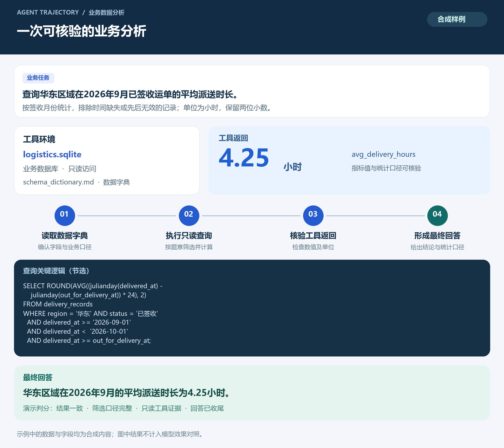

# Agent 轨迹评测文档

## 1. 文档目的

本文说明物流与供应链业务场景下的 Agent 轨迹评估方法，涵盖评估任务、Agent 运行配置、评分标准、数据示例及模型对照结果。

评估对象是模型在业务环境中完成任务的全过程：理解业务问题、读取数据字典、调用工具查询数据、处理工具返回，最终形成可核验的业务回答。评估既关注答案是否正确，也关注执行过程、任务完成情况和工具使用效率。

被评模型为原始 **Qwen3.6-27B** 基座与垂域训练后的 **Step120**。本文的 Step120 指垂域训练版本，不包含后续开源数据续训版本。

## 2. 评估任务与 Agent 配置

### 2.1 评估任务

任务围绕物流业务数据分析展开，由自然语言业务指令、可操作的沙箱环境和评判条件组成。

| 任务形式 | 典型业务问题 | 主要考察能力 |
| --- | --- | --- |
| 数值查询 | 查询指定区域、时间范围内的平均时长或业务指标 | 条件理解、时间口径、聚合计算、单位转换 |
| 结果表生成 | 按业务维度分组，输出指标明细、排序或排名 | 分组与关联、完整行列、排序和结果格式 |
| 多轮业务分析 | 读取业务资料与数据字典，再查询数据库并形成结论 | 信息定位、工具选择、多步执行和结论收尾 |

任务输入与评分信息分开管理。Agent 可以读取业务指令、数据字典、业务资料及任务所需数据库；标准答案、验证 SQL 和判分元信息仅供评分器使用。

### 2.2 Agent 运行方式

评估采用 **PI-Agent 工具协议**，通过接入 veRL 的 `PiAgentLoop` 执行多轮交互。模型负责决定下一步动作，Agent 负责解析工具调用、在独立工作区执行操作，并将工具结果返回模型；模型推理由 vLLM-Ascend 提供。

```text
业务指令 → 模型生成动作 → Agent 执行工具 → 工具结果返回
                  ↑                         │
                  └──── 继续分析或查询 ──────┘
                              ↓
                         最终业务回答
```

PI-Agent 原生会话与 veRL 中的 PI 工具适配共享工具协议，但并非完全相同的运行时。本文效果对照采用相同的 `PiAgentLoop` 执行路径，避免将不同运行时的结果混在一起。

### 2.3 工具与业务环境

| 工具或环境 | 作用 |
| --- | --- |
| `read` | 读取数据字典、业务说明及执行产物 |
| `bash` | 执行命令、通过 SQLite 查询业务数据 |
| `write` | 在任务工作区保存临时脚本或分析结果 |
| `edit` | 修改任务工作区内的临时文件 |
| `logistics.sqlite` | 提供业务查询的数据环境，按只读要求访问 |
| `schema_dictionary.md` | 说明表结构、字段及业务含义 |
| `documents/` | 提供任务环境中配备的业务规范或说明资料 |

每条轨迹使用独立工作区，避免不同任务之间残留文件或执行状态相互影响。工具调用及其返回结果随轨迹保留，用于后续过程分析和评分复核。

### 2.4 基座对照的关键配置

| 配置项 | 对照条件 |
| --- | --- |
| 模型 | 原始 Qwen3.6-27B 与垂域 Step120 |
| 任务输入 | 相同业务指令、提示词及任务环境 |
| Agent | PI 工具协议与 `PiAgentLoop` |
| 工具集合 | `bash`、`read`、`write`、`edit` |
| 解码方式 | Greedy，`temperature=0`，关闭随机采样 |
| 总上下文长度 | 49,152 tokens |
| 交互预算 | 最多26个 assistant 回合、25次工具反馈 |
| 评估模式 | 仅推理，不更新模型权重 |
| 评分版本 | 相同的原版轨迹解析器与评分器 |

对照前检查模型权重身份：基座使用原始权重，Step120 必须完成训练权重到推理服务的同步。权重未同步、工具接口配置错误或对照合同不一致的整次运行，不作为有效模型对照。有效运行中由模型产生的工具调用错误和未完成任务仍计入统计。

## 3. 评分标准

### 3.1 评分流程

```text
保留完整轨迹 → 解析最终回答和工具记录 → 对齐任务评判条件
            → 计算结果与过程指标 → 汇总同题模型对照
```

评估使用程序化轨迹解析与评分。本文展示的基座对照直接采用原版 `judge_trajectory` 与 `reward_judge` 流程，未启用 LLM judge。

### 3.2 评分维度

| 维度 | 评判内容 | 分数解读 |
| --- | --- | --- |
| 结果正确性 | 最终回答是否满足任务规定的答案判定条件 | 单独报告，不能用过程得分替代 |
| 任务完成 | 是否形成符合要求的最终回答，是否因预算耗尽而未收尾 | 未完成情况保留在结果中 |
| 过程质量 | 必需表、字段、业务资料及任务适配等证据 | 反映过程命中情况，不等同于答案正确 |
| 执行效率 | 工具调用、SQL、重复命令及交互开销 | 用于诊断，原版综合分不直接加入效率奖励 |

数值类任务依据评分器提取的结果与标准值判定；表格类任务依据对应版本的表格判定规则处理。不同版本对终值提取、完整行列及排序的要求可能不同，因此评分版本必须固定。后续严格终值和证据校验的复评分，与本文历史对照分别记录，不替换或拼接历史分数。

### 3.3 原版综合评分

原版综合得分由结果分和过程分组成，取值范围为 **0–1**。

```text
结果分 = 0.5 × 有合格最终回答 + 0.5 × 数值结果正确

过程分 = 表命中、字段使用、资料命中、任务适配的加权得分

综合得分 = 0.5 × 结果分 + 0.5 × 过程分
```

过程分对应的原始权重为：表命中0.30、字段使用0.30、资料命中0.20、任务适配0.20。不适用维度不参与，并对其余权重重新归一。没有合格最终回答时，综合得分按原评分器的硬门控规则归零。

综合得分包含过程成分，因此不能直接读作正确率。结果错误而过程命中较高的轨迹，仍可能获得一定综合分；效果报告同时列出正确性、完成率和“结果错误但过程达标”的占比。

### 3.4 结果指标定义

| 指标 | 定义 | 方向 |
| --- | --- | --- |
| 数值结果正确率 | 原版评分字段 `result_correct_numeric` 通过的任务占比 | 越高越好 |
| 严格正确判定率 | 原版评分器 `verdict=correct` 的任务占比 | 越高越好 |
| 完整回答率 | 原版评分字段 `result_complete` 通过的任务占比 | 越高越好 |
| 高过程分错答占比 | 原版判定为 `result_wrong_process_ok` 的任务占比 | 越低越好 |
| 平均综合得分 | 原版 `reward_total` 的均值 | 越高越好，但须结合前述指标解读 |

## 4. 数据与轨迹示例

以下为**合成物流业务样例**，用于展示任务结构、Agent 交互和判分方式，不对应真实企业数据，也不作为模型效果证据。



### 4.1 任务数据的简化视图

| 信息层 | 示例内容 | 可见范围 |
| --- | --- | --- |
| 业务指令 | 请查询华东区域在2026年9月已签收运单的平均派送时长。按签收日期归属月份，只统计派送与签收时间均完整且先后有效的记录，单位为小时，保留两位小数。 | Agent 可见 |
| 环境 | 数据库、数据字典及任务工作区 | Agent 可见 |
| 结果类型 | 数值，单位为小时 | 评分器保存判分元信息 |
| 标准结果 | `4.25` | 仅评分器可见 |
| 验证逻辑 | 区域、签收状态、签收月份、时间有效性及平均时长计算 | 仅评分器持有验证 SQL；Agent 自行生成查询 |

### 4.2 Agent 执行过程

Agent 先读取数据字典，确认派送时间、签收时间、区域和状态字段，再通过 `bash` 调用 SQLite 执行只读查询。以下查询属于合成样例的演示实现：

```sql
SELECT ROUND(
    AVG((julianday(delivered_at) - julianday(out_for_delivery_at)) * 24),
    2
) AS avg_delivery_hours
FROM delivery_records
WHERE region = '华东'
  AND status = '已签收'
  AND delivered_at >= '2026-09-01'
  AND delivered_at <  '2026-10-01'
  AND out_for_delivery_at IS NOT NULL
  AND delivered_at IS NOT NULL
  AND delivered_at >= out_for_delivery_at;
```

工具返回：

| avg_delivery_hours |
| ---: |
| 4.25 |

最终回答示例：

> 华东区域在2026年9月已签收运单的平均派送时长为 **4.25小时**。统计按签收日期归属月份，并已排除派送或签收时间缺失、时间先后无效的记录。

### 4.3 示例判分

| 检查项 | 演示判定 |
| --- | --- |
| 最终结果 | `4.25小时` 与标准结果一致 |
| 业务口径 | 区域、状态、月份归属及时间有效性条件一致 |
| 工具证据 | 存在实际只读查询及工具返回值 |
| 回答收尾 | 给出明确指标值、单位和统计口径 |

SQL、工具返回和最终回答可以相互核验。仅在回答中声称“已经查过数据库”，不能替代实际工具记录。

## 5. 相对于原始基座的评估效果

以下结果来自相同任务、提示词、工具环境、交互预算和原版评分器下的历史同题对照，且已核验两侧权重身份。百分比变化以**百分点**表示，综合分变化以0–1分值表示；均由未舍入结果计算后展示。

| 指标 | 原始 Qwen3.6-27B | 垂域 Step120 | 变化 |
| --- | ---: | ---: | ---: |
| 数值结果正确率 ↑ | 7.81% | 10.94% | **+3.13个百分点** |
| 严格正确判定率 ↑ | 3.13% | 7.81% | **+4.69个百分点** |
| 高过程分错答占比 ↓ | 20.31% | 12.50% | **−7.81个百分点** |
| 完整回答率 ↑ | 62.50% | 54.69% | −7.81个百分点 |
| 平均综合得分 ↑ | 0.2858 | 0.2612 | −0.0246 |

Step120 在本次对照中表现为：**数值正确性和严格正确判定率提高，高过程分错答占比降低；但完整回答率与平均综合得分下降。** 正确性改善尚未转化为整体任务完成能力的全面提升。

现有配对检验未支持在0.05显著性水平下将正确性、完成率或综合分差异认定为稳定提升或退化。因此，上表用于描述本次固定协议下的方向性结果，不作业务总体或未见任务的泛化承诺。

## 6. 评测执行与结果管理

评测按以下流程执行：

1. **冻结配置**：确定模型版本、任务定义、沙箱快照、提示词、工具协议、生成预算及评分版本。
2. **核验模型**：确认推理服务加载目标权重；训练模型额外核验权重同步完成。
3. **生成轨迹**：在独立工作区执行多轮工具交互，保留模型动作、工具返回和最终回答。
4. **统一评分**：解析轨迹，计算正确性、完成、过程及效率指标，并保留异常状态。
5. **同题比较**：按同一任务身份对齐模型结果，报告各指标的变化及配对结论。

| 产物 | 内容 |
| --- | --- |
| 配置快照 | 模型身份、Agent 和工具配置、生成与评分参数 |
| 完整轨迹 | 模型输出、工具调用、工具返回、终止状态 |
| 评分明细 | 结果判定、过程证据、综合分及异常标记 |
| 对照汇总 | 模型间百分比指标、平均得分及变化 |

原始任务、完整轨迹和内部核验记录保留在内部评测归档中。对外使用本文中的配置说明、合成示例与聚合指标。
